# Routing — how a request moves through the advisor

How every kind of request is routed: who handles it, what it calls, where data is read and written,
and what happens when something fails. Written from the code as of branch
`feature/learn-experiment-adk`; every box below is a real class or collection.

Companion docs: [ARCHITECTURE.md](ARCHITECTURE.md) (concepts, schema), [Optimization.md](Optimization.md)
(known gaps), [docs/design/](docs/design/) (design notes).

Diagrams are [Mermaid](https://mermaid.js.org/); they render on GitHub and in most IDE Markdown previews.

## Contents

1. [System map](#1-system-map)
2. [Endpoint routing table](#2-endpoint-routing-table)
3. [Chat turn — happy path](#3-chat-turn--happy-path)
4. [Chat turn — every way it can end](#4-chat-turn--every-way-it-can-end)
5. [Inside one turn — agents, model calls, tool loop](#5-inside-one-turn--agents-model-calls-tool-loop)
6. [Tool routing — which store each tool touches](#6-tool-routing--which-store-each-tool-touches)
7. [Document upload flow](#7-document-upload-flow)
8. [Authentication flow](#8-authentication-flow)
9. [How the app authenticates to Google Cloud](#9-how-the-app-authenticates-to-google-cloud)
10. [Observability write path](#10-observability-write-path)
11. [Startup flow](#11-startup-flow)
12. [Where data lives](#12-where-data-lives)
13. [What is retrieved, and what is deterministic vs probabilistic](#13-what-is-retrieved-and-what-is-deterministic-vs-probabilistic)
14. [What the prompts control vs what code controls](#14-what-the-prompts-control-vs-what-code-controls)
15. [Known weak spots in the routing](#15-known-weak-spots-in-the-routing)

---

## 1. System map

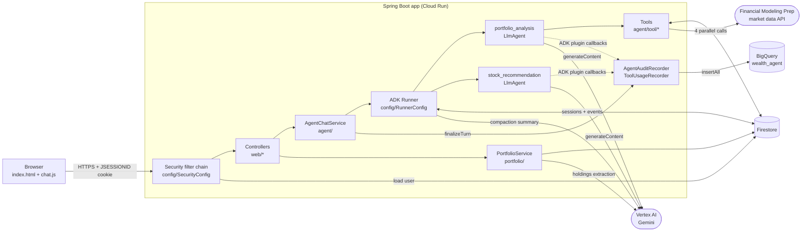

Two sequential agents share one ADK session. Only `portfolio_analysis` has tools. Everything the
model sees is rebuilt from the session's events on every model call.

---

## 2. Endpoint routing table

| Method + path | Auth | Handler | Calls | Success | Failure codes |
|---|---|---|---|---|---|
| `GET /login.html`, `/signup.html`, `/css/**`, `/js/**` | public | static resources | — | 200 | — |
| `POST /api/auth/login` | public | Spring `formLogin` → `FirestoreUserDetailsService` | Firestore `users/{name}` + BCrypt | 302 → `/index.html` + cookie | redirect to `/login.html?error` |
| `POST /api/auth/register` | public | `RegistrationController` → `UserRegistrationService` | Firestore `users` | 200 | 409 (invalid or username taken) |
| `POST /api/auth/logout` | cookie | Spring logout | clears `JSESSIONID` | 302 | — |
| `POST /api/chat` | required | `ChatController.chat` → `AgentChatService.chat` | full agent turn (sections 3–5) | 200 `{sessionId, reply}` | 400, 401, 404, 409, 429, 500 |
| `GET /api/sessions` | required | `ChatController.sessions` | ADK `listSessions` + per-session `getSession` for titles | 200 list | 401 |
| `GET /api/sessions/{id}/messages` | required | `ChatController.messages` | ADK `getSession` | 200 list | 401, 404 |
| `DELETE /api/sessions/{id}` | required | `ChatController.deleteSession` | ADK `deleteSession` | 204 | 401, 404 |
| `POST /api/portfolio/upload` | required | `PortfolioController` → `PortfolioService.ingest` | section 7 | 200 `{filename, chunksStored}` | 401, **422** (not a portfolio statement), 500 |
| `GET /api/portfolio/documents` | required | `PortfolioController` | Firestore `portfolio_documents` | 200 list | 401, 500 |
| `DELETE /api/portfolio/documents/{filename}` | required | `PortfolioController` | batch delete in 3 collections | 200 | 401, 500 |
| anything else, unauthenticated | — | entry point | — | `/api/**` → **401**; pages → **302** to `/login.html` | — |

`userId` always comes from the authenticated principal (`authentication.getName()`), never from the
request body, so a caller cannot name another user.

---

## 3. Chat turn — happy path

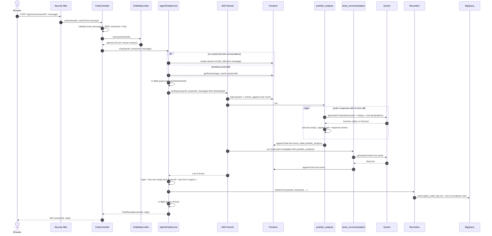

Notes that are easy to miss:

- The Runner blocks the request thread until the **whole** turn is done (`toList().blockingGet()`);
  there is no streaming. A turn is typically several seconds.
- Both agents' model calls resend the session history; agent 2 additionally receives agent 1's tool
  calls and results rewritten as `For context: [portfolio_analysis] ...` text.
- The user sees only agent 2's text. Agent 1's text is internal (the hand-off).

---

## 4. Chat turn — every way it can end

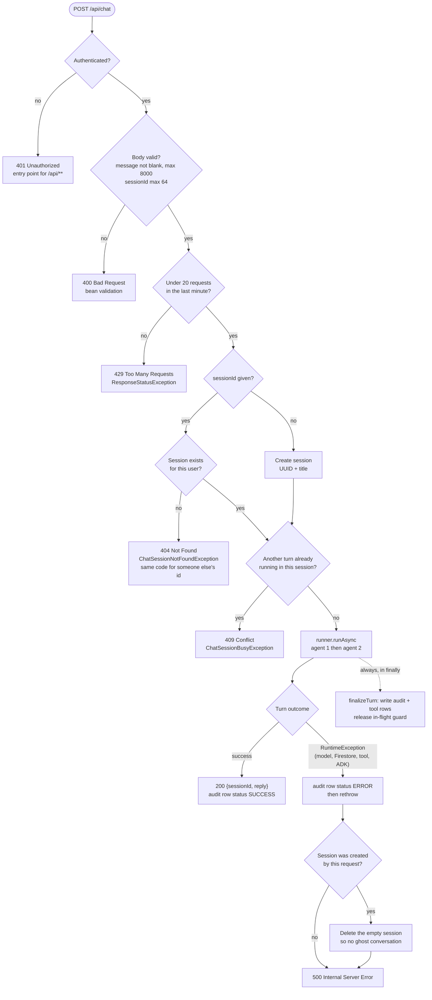

What is **not** a failure of the turn, by design:

| Situation | What happens instead |
|---|---|
| Long-term memory search errors (e.g. missing Firestore index) | `GuardedMemoryService` returns "no memories", logs WARN, turn continues |
| FMP returns non-200, times out, or no API key is set | `MarketDataService` returns `found: false`; the model is told the data is missing |
| BigQuery insert fails when finalizing | caught and logged; the user still gets their reply |
| Tool reports nothing found (`found: false`) | normal tool result, the model decides what to say |

What **does** fail the whole turn today (surfaces as 500): an exception thrown from inside a tool
(for example a Firestore query failure in `getPortfolioHoldings`), a Gemini/Vertex failure, or an
ADK-internal error such as a function-call argument that fails schema validation.

---

## 5. Inside one turn — agents, model calls, tool loop

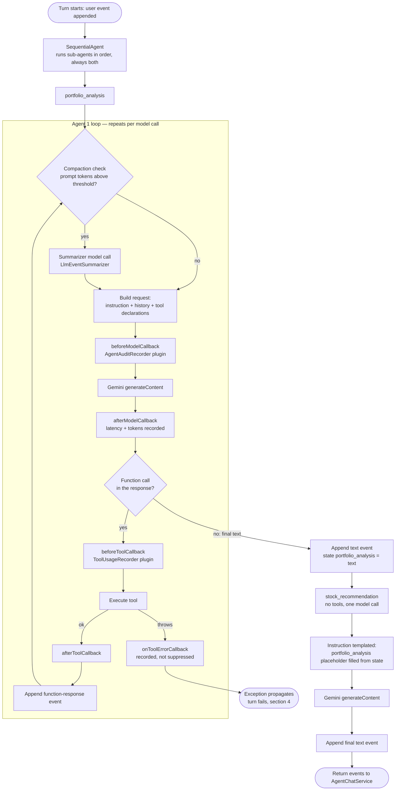

Facts behind the boxes (verified in ADK 1.7.0 sources):

- `SequentialAgent` runs every sub-agent every turn; nothing can skip the second one.
- Compaction runs as a request processor **before each model call** and is synchronous. It has not
  been seen to fire in real data, and its persistence across turns is unproven
  (see [section 15](#15-known-weak-spots-in-the-routing)).
- The loop ends only when the model returns a response containing no function call. The only
  built-in bound is `RunConfig.maxLlmCalls` (default 500); we do not set it.

---

## 6. Tool routing — which store each tool touches

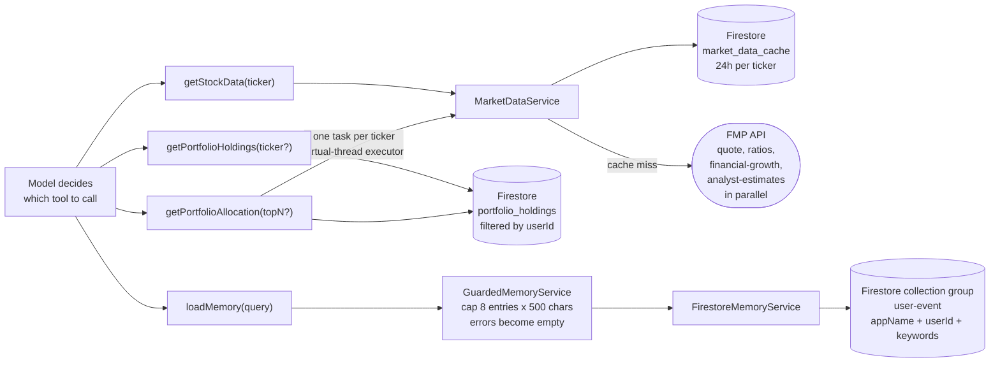

| Tool | Reads | Writes | Degrades to | Throws on |
|---|---|---|---|---|
| `getStockData` | `market_data_cache`, FMP | `market_data_cache` | `found: false` (no key, non-200, parse error) | — |
| `getPortfolioHoldings` | `portfolio_holdings` | — | `found: false` | Firestore failure |
| `getPortfolioAllocation` | `portfolio_holdings`, `market_data_cache`, FMP | cache | per-ticker `pricingUnavailableFor` | Firestore failure |
| `loadMemory` | `user-event` collection group | — | empty memories | — (guarded) |

Every tool takes `userId` from ADK's `ToolContext`, never from a model-supplied argument, so the
model cannot ask for another user's data.

---

## 7. Document upload flow

Only **portfolio statements** are accepted. The check is by outcome: holdings are extracted
**before** anything is stored, and a file with none is rejected.

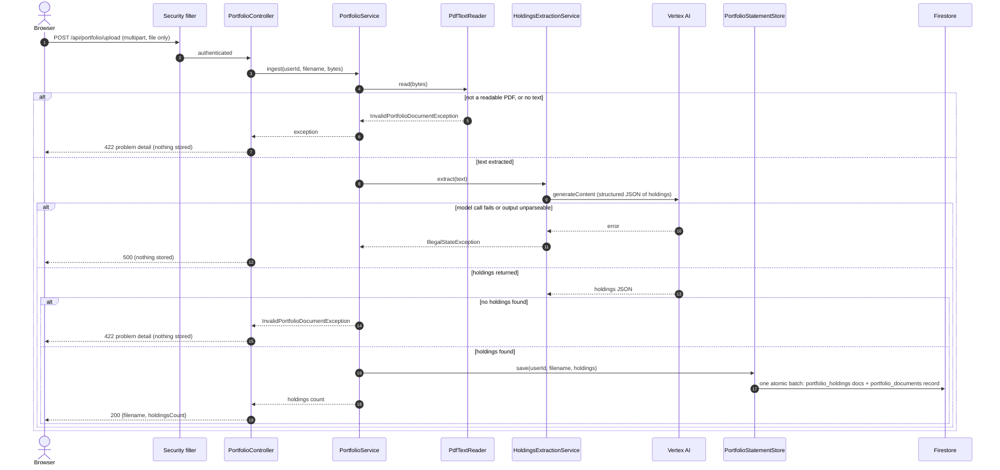

The 422 body is Spring's standard `ProblemDetail`, built by `ApiExceptionHandler` (the controller just
throws). Delete (`DELETE /api/portfolio/documents/{filename}`) removes the statement's holdings and its
record in batched deletes, filtered by `userId` and `filename`.

Failure behavior:

| Situation | Result |
|---|---|
| Not a PDF, corrupt or password protected | 422 with a user-readable message; nothing stored |
| PDF with no text (scanned image) | 422; nothing stored |
| No holdings found (resume, bank statement, anything else) | 422; nothing stored |
| Gemini call fails or returns unparseable output | 500; nothing stored (never reported as "not a statement") |
| Firestore failure while saving | 500; the holdings and record are written in one batch, so a statement is stored fully or not at all |
| File larger than 10MB | rejected by Spring's multipart limit (`spring.servlet.multipart.max-file-size`) |

---

## 8. Authentication flow

```mermaid
flowchart TD
    subgraph LOGIN["Login"]
        L1["POST /api/auth/login<br/>username + password form"] --> L2["FirestoreUserDetailsService<br/>load users/{username}"]
        L2 --> L3{"User found and<br/>BCrypt matches?"}
        L3 -- yes --> L4["Create session<br/>Set-Cookie JSESSIONID<br/>HttpOnly, SameSite=Lax"]
        L4 --> L5["302 to /index.html"]
        L3 -- no --> L6["302 to /login.html?error"]
    end

    subgraph REG["Register"]
        R1["POST /api/auth/register<br/>JSON username, email, password"] --> R2{"Username 3-30 chars<br/>letters digits _ -<br/>password min length?"}
        R2 -- no --> R5["409 with error message"]
        R2 -- yes --> R3{"users/{username}<br/>already exists?"}
        R3 -- yes --> R5
        R3 -- no --> R4["Write users/{username}<br/>email, BCrypt hash, createdAt"]
        R4 --> R6["200 {username}<br/>then client goes to login"]
    end

    subgraph GUARD["Every other request"]
        G1["Request"] --> G2{"Valid session cookie?"}
        G2 -- yes --> G3["Continue to controller"]
        G2 -- no --> G4{"Path under /api/**?"}
        G4 -- yes --> G5["401"]
        G4 -- no --> G6["302 to /login.html"]
    end
```

CSRF tokens are disabled; the app relies on the same-origin `SameSite=Lax` cookie instead
(see `SecurityConfig`). Passwords are stored only as BCrypt hashes.

---

## 9. How the app authenticates to Google Cloud

Section 8 is how a **user** logs in to the app. This is the other direction: how the **app**
proves its identity to Firestore, BigQuery and Vertex AI. No credential appears anywhere in the
code; the client libraries and the platform handle it.

### On Cloud Run

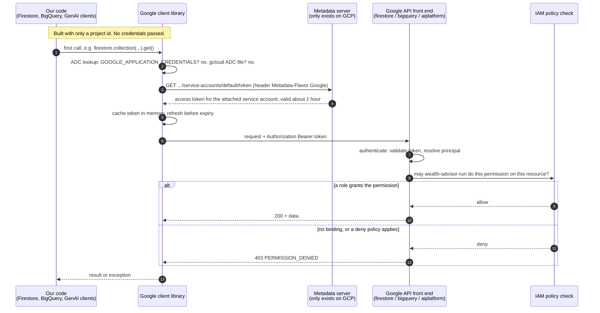

### Where the credential comes from

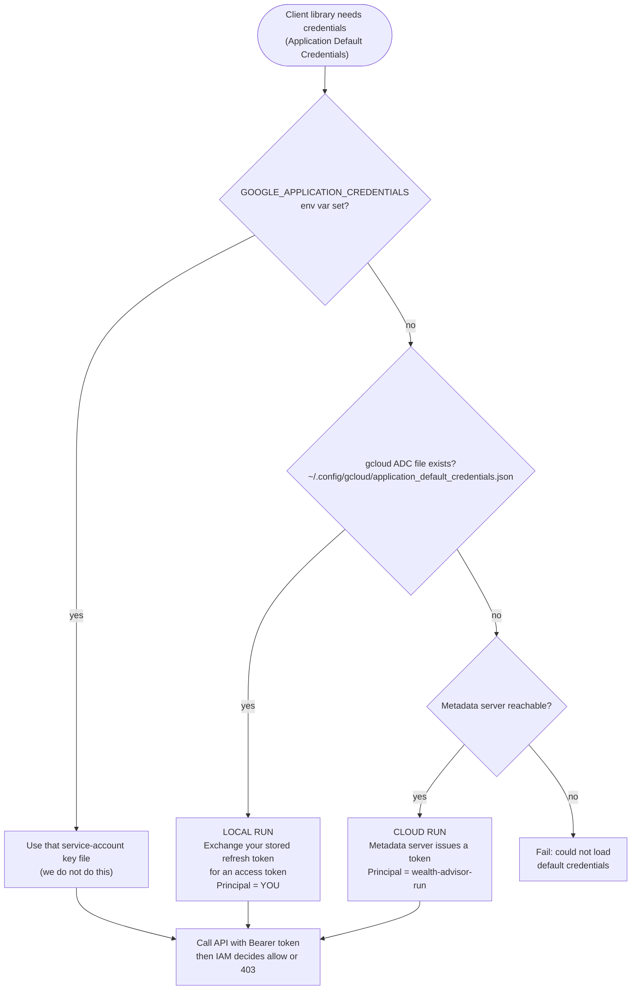

### What we write vs what is automatic

| We write or configure | The platform and libraries do |
|---|---|
| The project id (`gcp.project-id`) | ADC discovery order |
| `serviceAccountName` on the Cloud Run revision | Issuing and rotating the signing keys (system-managed, not downloadable) |
| IAM role grants for that account | Minting a short-lived access token, caching and refreshing it |
| Env vars that pick the Vertex route (`GOOGLE_GENAI_USE_VERTEXAI`, project, location) | Attaching the Bearer token to every gRPC or REST call, TLS |
| Nothing else; no key file, no token code | Authentication, then the IAM authorization decision |

### Which role is used by what

`wealth-advisor-run` holds five project roles; every component shares all of them.

| Role | Used for |
|---|---|
| `roles/datastore.user` | All Firestore reads and writes: sessions and events, users, `portfolio_*`, `market_data_cache` |
| `roles/aiplatform.user` | Gemini calls (both agents, the compaction summarizer, holdings extraction) |
| `roles/bigquery.dataEditor` (project level) | Inserting audit and tool rows; creating the dataset and tables at startup |
| `roles/bigquery.jobUser` | Running query jobs |
| `roles/secretmanager.secretAccessor` | Reading `FMP_API_KEY` if it is stored in Secret Manager |

### Local runs are a different identity

Running locally uses the **ADC file, which is your own user account**, not the service account.
Every local test therefore runs with your (broad) permissions. A local pass proves nothing about
whether `wealth-advisor-run` has enough access; the deployed service is the first real test of its
roles.

| Symptom | Meaning | First thing to check |
|---|---|---|
| `401` / "could not load default credentials" | no valid credential found, or token expired | locally: `gcloud auth application-default login`; on Cloud Run: is a service account attached? |
| `403 PERMISSION_DENIED` | authenticated, but IAM has no allowing binding | the permission named in the error against the account's roles (Policy Troubleshooter) |

---

## 10. Observability write path

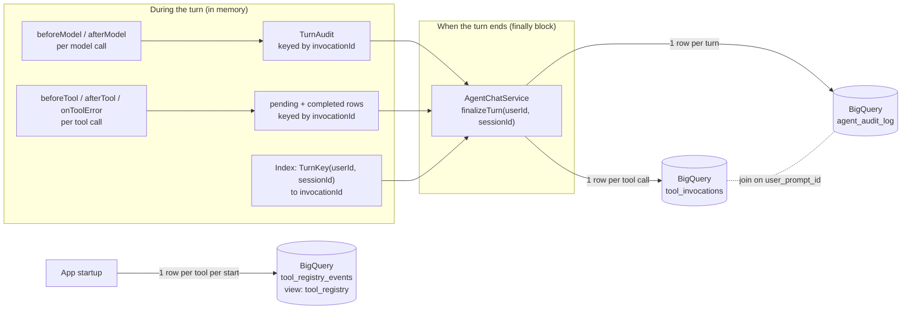

- Rows are accumulated in memory and written once, when the turn ends. A process crash mid-turn
  loses that turn's rows.
- A normal failure still writes a row (`status = ERROR`) because finalization is in `finally`.
- Requests rejected before the chat service (400, 401, 429) leave no audit row.
- The recorders are ADK global plugins registered once on the `App` (`RunnerConfig.advisorApp`), so
  they see every agent's calls with no per-agent wiring.
- The compaction summarizer's model call does not pass through these plugin callbacks, so it is
  not recorded.

---

## 11. Startup flow

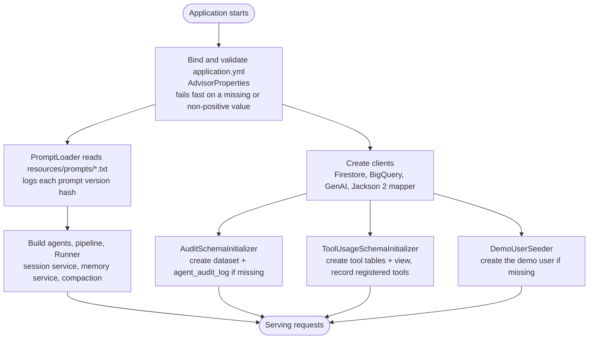

---

## 12. Where data lives

| Store | Collection / table | What | Written by | Read by |
|---|---|---|---|---|
| Firestore | `users/{username}` | account, BCrypt hash | registration, ingestion | login |
| Firestore | ADK session collections | session doc (state, title) + `user-event` subcollection (the conversation) | ADK session service | Runner every model call, history API, memory search |
| Firestore | `portfolio_documents` | one metadata doc per upload | ingestion | document list |
| Firestore | `portfolio_holdings` | one doc per holding per upload | ingestion | holdings and allocation tools |
| Firestore | `market_data_cache` | FMP result per ticker, 24h | `MarketDataService` | `MarketDataService` |
| BigQuery | `wealth_agent.agent_audit_log` | one row per turn | `AgentAuditRecorder` | analysis |
| BigQuery | `wealth_agent.tool_invocations` | one row per tool call | `ToolUsageRecorder` | analysis |
| BigQuery | `wealth_agent.tool_registry_events` + `tool_registry` view | tools seen at startup | initializer | analysis |

Names live in `constants/FirestoreCollections` and `constants/BigQueryNames`. Tunables
(limits, thresholds, model names) live in the `advisor.*` block of `application.yml`.

---

## 13. What is retrieved, and what is deterministic vs probabilistic

### What goes into the model's context

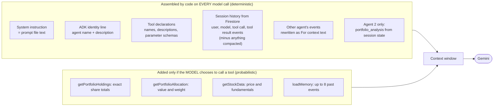

Not retrieved automatically, ever: **other sessions** (only reachable through `loadMemory`), a
**user profile** (does not exist yet), and the user's **uploaded documents** (only through a tool).

### Deterministic vs probabilistic, step by step

| Step | Deterministic? | Why |
|---|---|---|
| Auth, validation, rate limit, session ownership, in-flight guard | **Deterministic** | plain code, same input gives the same result |
| Which agents run and in what order | **Deterministic** | `SequentialAgent` always runs both |
| Prompt text, tool declarations, history assembly, compaction trigger | **Deterministic** | code and static files (the summary text itself is not, see below) |
| **Whether** a tool is called | **Probabilistic** | the model decides, steered by the prompt |
| **Which** tool, and its arguments (ticker, search query, topN) | **Probabilistic** | model output |
| How many loop iterations | **Probabilistic** | depends on what the model asks for next |
| The **query text** used for `loadMemory` | **Probabilistic** | written by the model, then keyword-matched |
| What a tool **does** once called (Firestore queries, sums, weights, rankings, forward P/E, cache TTL) | **Deterministic** | plain Java; same data in gives the same answer |
| Prices and fundamentals | **Deterministic code over external data** | values change as FMP data changes; cached up to 24h |
| Holdings **extracted from an uploaded PDF** | **Probabilistic** | an LLM turns text into structured rows at upload time; later sums are exact *over those rows* |
| Compaction summary text | **Probabilistic** | an LLM summarizes (and it is lossy) |
| Agent 1's analysis, agent 2's reply, wording, numbers copied into the reply | **Probabilistic** | model generation; nothing checks that quoted figures match tool output |
| Which text is shown to the user | **Deterministic** | last non-empty text event of the turn |
| Audit rows, error to status-code mapping, reply format | **Deterministic** | plain code |

The practical rule: **retrieval mechanics are deterministic, but the decision to retrieve and the
words used to retrieve are the model's.** That is why a fact that must always be known (a user's
risk tolerance, say) should not depend on the model choosing to call a tool.

---

## 14. What the prompts control vs what code controls

There is **no separate global "system prompt"** in this app. Each agent has one `instruction`, loaded
from `resources/prompts/<name>.txt`, and ADK sends it as that model call's system instruction.
So "system prompt" and "agent prompt" are the same thing here; there are two of them, one per agent.

ADK adds a little on top of ours, also as system-instruction text:

| Added by | Text | Source |
|---|---|---|
| ADK `Identity` | `You are an agent. Your internal name is <name>. The description about you is "<description>".` | the agent's `name` and `description` in `AgentConfig` |
| ADK `LoadMemoryTool` (agent 1 only) | `You have memory ... call loadMemory function with a query.` | built into the tool |
| ADK `Instructions` | `{portfolio_analysis}`-style placeholders replaced from session state (agent 2) | session state |

### What each prompt influences (all of this is probabilistic)

| Prompt file | Governs | Does **not** govern |
|---|---|---|
| `portfolio_analysis.txt` (agent 1) | which tools to call and when ("always call both `getPortfolioAllocation` and `getStockData` for a buy question"), never asking permission to look something up, grouping holdings by sector, "2-3 sentences, don't address the user" | what the tools return, whether agent 2 runs, what the user sees |
| `stock_recommendation.txt` (agent 2) | tone, taking a position instead of deflecting, the one-line risk disclaimer, how to treat missing data | which tools exist (it has none), what data it received (that is agent 1's output and history) |

### What only code controls (a prompt cannot change it)

| Concern | Enforced by |
|---|---|
| Whose data a tool can read | `userId` from `ToolContext`, bound by ADK, not a model argument |
| What arguments a tool accepts | `@Schema` declarations; ADK rejects a malformed call before our code runs |
| That both agents run, in order | `SequentialAgent` |
| Message size, rate limit, session ownership, one turn per session | `ChatRequest`, `ChatRateLimiter`, `AgentChatService` |
| How much memory the model can receive | `GuardedMemoryService` (8 entries, 500 chars) |
| When history is trimmed | compaction thresholds in `advisor.compaction.*` |
| Exact numbers computed from holdings | tool Java code |
| What is logged | recorders |

### Where a prompt is the *only* control (the soft spots)

These behaviors rest on wording alone, so they can drift with model version or phrasing:
"call both tools before a buy recommendation", "do not address the user directly" (agent 1 was
observed doing exactly that), "always give a one-line disclaimer", and "do not deflect with
boilerplate". The right way to harden any of them is to move it into code (a guardrail or a
post-check), or to measure it with an eval, rather than to add more words to the prompt.

---

## 15. Known weak spots in the routing

Stated plainly so the diagrams are not read as a guarantee.

| # | Weak spot | Why it matters | Status |
|---|---|---|---|
| 1 | **Compaction may not persist across turns.** The Firestore session service stores only author, timestamp, content parts and keywords, not the event `actions` where a summary lives. | The summary could be lost on reload and re-created every turn. | Suspected from source, **unverified**; never fired in real data |
| 2 | **Long-term memory returns nothing until a Firestore index exists.** | `loadMemory` silently degrades to empty. | Index not created; needs approval |
| 3 | **Tool exceptions fail the whole turn** (500). | One flaky Firestore read costs the user the entire answer. | Open |
| 4 | **In-flight guard and rate limiter are per instance.** | With several Cloud Run instances the same session or user could be served in parallel / exceed the limit. | Open |
| 5 | **Agent 2 always runs**, even for a plain lookup. | Extra serial model call and tokens per turn. | Under discussion |
| 6 | **The tool-call loop is effectively unbounded.** `LlmAgent.maxSteps` is not set (default unbounded) and `RunConfig.maxLlmCalls` is ADK's default of 500. | A model stuck re-calling tools runs up cost and latency before anything stops it. | Open; set `maxSteps` per agent |
| 7 | **No prompt-injection or output guardrails on the request path** beyond log-forging sanitization. | Untrusted text (user input, tool output, uploaded PDFs) reaches the model unfiltered. | Planned (guardrails topic) |
| 8 | **Stack traces appeared in the 500 JSON in the local run** (DevTools sets this for development). | Must not be present in a production build. | Confirm on the deployed image |
| 9 | **Audit rows are lost on a crash, and rejected requests are not audited.** | Gaps in the analysis data. | Open (observability topic) |
