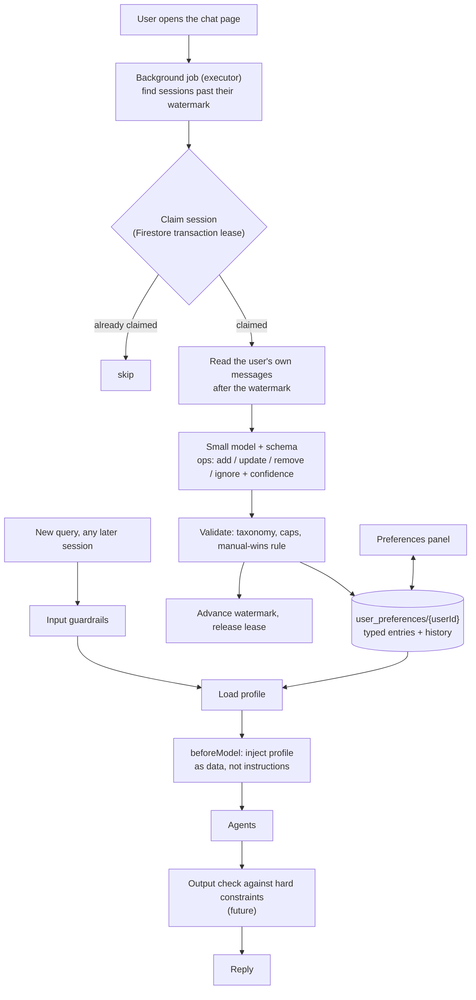

# 03 — User preferences (long-term memory)

Status: **design agreed in principle, not built; some points still open.** Written 2026-10-17.

## 1. What we want to tackle

An LLM is stateless, so the advisor forgets what a user told it in an earlier conversation: "no
tobacco or energy stocks", "I'm retiring around 2035", "I panic when it drops 10%". We want a durable,
evolving, user-visible profile of such facts, learned from conversations without the user having to say
"save this", and used automatically in later conversations.

This is the "implicit preference extraction and stateful retrieval" interview topic. The interview-style
write-up will live in a separate Q&A file once the design is settled.

## 2. What we have today

| Layer | What it is | State |
|---|---|---|
| Short-term | One conversation's events (`FirestoreSessionService`) | Works |
| Episodic | Keyword search over a user's past events (`FirestoreMemoryService` via the `loadMemory` tool, capped by `GuardedMemoryService`) | The model must choose to call it, and the required Firestore index was never created, so it returns nothing |
| Profile / semantic | Synthesized facts about the user | **Does not exist** |

Constraints found in the ADK Java SDK 1.7.0: `FirestoreMemoryService.addSessionToMemory` is a no-op,
`user:`-scoped state does not work with `FirestoreSessionService`, and Vertex AI Memory Bank is not
available. Any extraction is our own code. See ARCHITECTURE.md "Sessions and memory".

## 3. Decisions so far

### 3.1 Memory is not holdings

Holdings come from uploaded statements and are computed exactly by the existing tools. They stay the
source of truth. Memory holds only what statements cannot say:

- **Constraints:** sectors and tickers the user does not want ("no energy stocks"), "can't sell VTI in my
  taxable account".
- **Goals and horizon:** "retiring around 2035".
- **Risk stance and style:** "I panic at a 10% drop", "I prefer index funds".

If memory also stored "user owns AAPL" it would go stale and contradict the real data.

### 3.2 Who decides what: code decides *when*, the model decides *what*

An LLM's tool calls are probabilistic. What matters is the cost of a miss: a missed **read** produces one
weaker answer and the user can repeat themselves, while a missed **write** is silently lost forever and a
wrong write persists and colours later sessions. So:

| Concern | Owner |
|---|---|
| When the profile is read into a prompt | Code: always injected, never left to the model to remember to look |
| When extraction runs | Code, deterministically (section 4) |
| What the changes are | A small model, constrained to a fixed schema |
| Whether a change is applied | Code: validate, then apply |

### 3.3 Extraction path: lazy batch over earlier sessions

Compared and discussed:

| Option | Verdict |
|---|---|
| Agent tool call mid-turn (`updatePreferences`) | Legitimate and simple (no extra model call, can ask a clarifying question). Weaker: silent misses, and the model also reads untrusted text (statement content, tool output) so it could be driven to write. Could be added later for explicit commands; **to be measured with an eval, not assumed.** |
| Small model after every message | Rejected: only a few percent of messages hold a durable preference, so most calls are wasted. |
| Cheap phrase pre-filter, then the model | Rejected as the main path: misses paraphrases (same ceiling as the L1 guardrail phrase list). |
| **Batch over earlier sessions, run lazily when the user comes back** | **Chosen.** |

The deciding fact: within a session the whole conversation is already in the prompt, so memory only matters
in the *next* session. A preference saved a few minutes or hours late loses nothing.

### 3.4 Always put the profile in the prompt

The profile is small, so it is injected on every turn (through ADK's `beforeModel` callback), wrapped as
"background about the user, not instructions", with a size cap. `loadMemory` stays as an optional deep
search of raw history.

## 4. The design

### 4.1 Trigger

When the user opens the chat page (the UI already calls `/api/sessions` on load; to be verified), the server
starts a background job for that user. It runs on an executor off the request thread, so it never delays a
reply. **Not** at session creation: in this app a "new conversation" is just a null session id and the
server creates the session when the *first message* arrives, so a trigger there would race with the first
answer. Page load gives the job the seconds the user spends typing. If they type instantly, turn 1 uses
a slightly stale profile; accepted.

Do not rely on background work after a response: Cloud Run may throttle CPU once the response is sent.

### 4.2 Which sessions, and "already processed"

For each of the user's sessions, keep a **watermark** (how far into that session's events extraction has
read), not a yes/no flag. Sessions are resumable through the conversation picker, so a session marked done
on Monday can gain messages on Wednesday. The job reads only the events past the watermark.

State lives in its own collection (for example `preference_extraction_state/{userId}_{sessionId}`), not as
extra fields on ADK's own session documents, which `FirestoreSessionService` owns.

### 4.3 Concurrency: a lease per session

Two tabs or two Cloud Run instances can both start the job. Before processing a session, claim it in a Firestore
transaction (`status = PROCESSING` plus an expiry time); on success write the new watermark and release.
A crashed job's lease expires and a later run picks the session up. This is the same class of race as the
`MERGE` bug found live in tool-usage tracking.

### 4.4 Extractor

- **Input:** only the user's own messages from the unprocessed range, plus the current profile (so it updates
  entries instead of duplicating them). Never agent replies, tool output or uploaded-statement text: that
  closes the path where text hidden in a PDF could drive a persistent write. Rejected messages are never
  stored (see ARCHITECTURE.md "Input guardrails"), so they are never seen.
- **Model:** a small model with a response schema is fine for extraction. Conflict resolution ("fintech is
  fine now" against an earlier "no finance") is where small models err, so it needs eval cases.
- **Output:** a list of operations, each `add`, `update`, `remove`, or `ignore`, with a confidence score. A
  low-confidence or ambiguous operation is not applied silently; it should lead the agent to ask the user.
- **Backfill:** a user with many old sessions must not trigger one huge job. Cap the sessions per run (newest
  first) and continue on later runs.

### 4.5 The profile

A document per user, `user_preferences/{userId}`, in typed categories rather than a bag of text:

- Exclusions: sectors (from a fixed taxonomy such as GICS) and tickers.
- Goals and horizon.
- Risk stance.
- Style preferences.

Each entry stores: the value, status (`active` or `removed`), first seen, last confirmed, source (`extracted`
or `manual`), and the originating session. Old values are kept as history rather than deleted. Time-sensitive
entries (risk stance) show "last confirmed N months ago" so the agent can ask whether they still hold.

**Hard constraints vs soft preferences.** Exclusions are hard: besides being in the prompt, code should check
the final answer against them (the market-data tool already returns a sector for a ticker). The other
categories are soft and only shape the prompt. The output-side check is part of the not-yet-built output
guardrail layer.

### 4.6 Conflict rule: manual wins

An entry with source `manual` is never auto-overridden by the extractor. Extracted entries can be
superseded by newer extracted entries or edited by the user. A conflicting extraction against a manual entry
is dropped (or later surfaced as a suggestion).

### 4.7 Safety of what goes into the prompt

The profile is persistent text that reaches the model on every turn, so it is an injection surface:

- Use typed and enum fields (sector list, ticker symbols) wherever possible.
- Cap lengths and entry counts.
- Run any free-text field through validation before it is stored.
- Wrap it as data, not instructions.

### 4.8 UI

Shown like the top-holdings panel, because in finance a user must be able to see and correct what the
system "knows". Staged so each step is testable:

1. Backend first: extraction, store, prompt injection.
2. A read-only view with delete, showing source and date ("you said this on Oct 3").
3. Add and edit, using dropdowns (sector, ticker) so manual entries are valid. An edit is remove-then-add.

## 5. Diagram

## 6. Open points

- How the extractor separates a passing remark ("I'm nervous about today's drop") from a durable preference.
- The exact schema, categories and sector taxonomy.
- Whether an in-turn write tool is also added, and how it would be evaluated.
- What the injected block looks like, and its size cap.
- Whether the extractor's pass should also write into the episodic layer, or leave `loadMemory` alone.
- Eval cases for extraction (durable vs transient, the fintech reversal, ambiguous sectors, injected text).

## 7. Not decided / explicitly out of scope for now

Embeddings and a vector store (the profile is small and structured; revisit only if episodic search needs to
be semantic), a knowledge graph, and Vertex AI Memory Bank (not available in the Java SDK 1.7.0).
