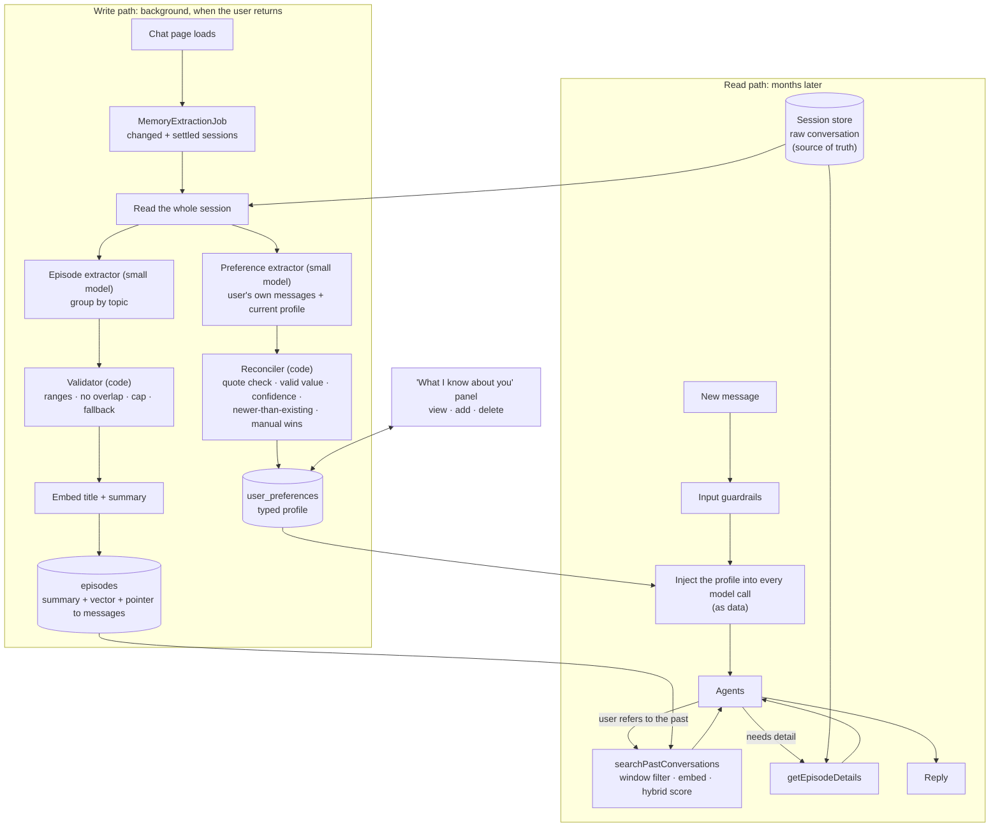

# Interview Q&A: Long-term memory, preference extraction and stateful retrieval for an agent

Revision notes for one question, answered two ways: **what the industry does**, and **what this repo
actually does and why**. Every "in this app" claim points at real code; where something is *not* built
it says so, and that honesty is worth keeping in an interview.

> **The question.** "How do LLM agents store, manage, update and retrieve implicit user preferences over
> time, without relying on explicit save commands or replaying the full chat history?" (E-commerce
> example: "Jordans hurt my heels, so I prefer other Nike models" must be respected two months later.
> Preference drift: a long-time vegetarian starts asking for fish.)

**30-second answer (memorize this).** A model is stateless, so memory is a system around it. Split it by
*what is being remembered*: the **current conversation** (already in the prompt), **facts about the user**
(a small, typed profile that is learned in the background and injected into every prompt so the model
never has to ask), and **past episodes** (summaries of earlier conversations that the model can search when
the user refers to them). Writes are decided by **code** (when) and a **small model** (what), then
**validated by code**, because a wrong write is silent and permanent. Reads of the profile are
**deterministic** (always injected); reads of episodes are **model-called tools**, because a miss is cheap.
Conflicts are settled by **evidence time** (newer statement wins) and by who said it (the user's own edit
always wins). The user can see and edit everything.

---

## Part 1 — Foundations

### Q1. What kinds of memory does an agent have?
| Type | What it holds | Example | In this app |
|---|---|---|---|
| **Working / short-term** | The current conversation, inside the context window | the last 10 messages | ADK session events in Firestore (`FirestoreSessionService`) |
| **Episodic** | *What happened*: past events, time-stamped | "last week we discussed the JPMorgan dividend idea" | `episodes` collection: topic summaries with embeddings, searched by two tools |
| **Semantic / profile** | *Facts about the user*, distilled | "avoids energy stocks", "retiring around 2035" | `user_preferences`: a typed profile, injected into every prompt |
| **Procedural** | *How to act* (skills, rules) | "always ask before executing" | not memory here: the agent prompts and tool code |

Taxonomy comes from cognitive science and is used by the CoALA paper and most frameworks. Be careful
with the word "episodic": LangMem uses it for stored *experiences* (situation, reasoning, outcome) used as
examples; here it means the human sense, time-stamped events.

### Q2. Where does each kind live? Do you need a vector database?
Separate stores, because the access patterns differ:

| Data | Store | Why |
|---|---|---|
| Raw conversation | the session store (Firestore, ADK) | source of truth; never copied |
| Profile facts | one document per user, typed entries | small, exact, enforceable; read whole on every turn |
| Episodes | one document each, with a vector | searched by meaning, by ticker and by time |

A vector store is **only for episodes**, and even there it is optional at small scale: a user has hundreds
of episodes, so the app reads that user's episodes and does the similarity in code (`EpisodeSearch`),
behind an interface so a vector index can replace it. The vector is stored as a Firestore *vector value*
so adding an index later needs no migration. Do not reach for a vector database for the profile: it is a
few dozen typed facts, and you want exactness, not nearest neighbours.

### Q3. Why isn't "just keep the whole chat history" the answer?
Cost (every old token is paid for on every turn), the context window (it runs out; this app already
compacts at 50,000 tokens), noise (months of unrelated chat dilute the signal), and privacy/retention
(you cannot delete one fact from a transcript). Memory is *compression with intent*: keep what will matter.

### Q4. Holdings are facts about the user too. Why aren't they memory?
Because they already have a **source of truth**: uploaded statements, summed exactly by the tools. If
memory also stored "owns 50 AAPL" it would go stale and contradict the real data. Memory holds only what
data sources cannot say: **constraints** ("no energy stocks"), **goals and horizon**, **risk stance**,
**style**. General rule: *derive from the source of truth where you can; remember only what you cannot
derive.*

---

## Part 2 — Writing memory

### Q5. Who decides what to save, and when? Tool call, or a background pass?
Three designs, with real trade-offs:

| Design | How | Strength | Weakness |
|---|---|---|---|
| **A. The agent saves via a tool** during the turn | the model calls `savePreference(...)` | no extra model call; can ask a clarifying question first; transparent ("noted") | **silent misses** (the model forgets); the model also read untrusted text (PDFs, tool output), so it could be steered into a persistent write |
| **B. Reflection after the turn** | a second model reads the turn | always runs | an extra call on every message, most of which hold nothing worth saving |
| **C. Batch over finished conversations** *(what we built)* | a background job, when the user returns | one pass per conversation; sees the whole conversation (context); off the request path | learns *late* |

Why C: memory only matters *across* conversations (within one, the full history is in the prompt), so
learning a little late loses nothing, and it avoids paying for a model call on every message. The principle
behind the choice: **code decides *when*, a small model decides *what*, code validates and applies.** A
missed *read* costs one weaker answer and self-corrects; a missed or wrong *write* is silent and persists.

### Q6. How does the batch job work, concretely?
1. The chat page calls `POST /api/memory/refresh` on load; it returns at once.
2. `MemoryExtractionJob` lists the user's sessions (cheap, no messages) and picks those that **changed**
   since last processed (last-update time) and have **settled** (quiet for 30 minutes, so a half-finished
   conversation is not summarised).
3. For each, it re-reads the **whole** session and recomputes everything derived from it.
4. It stores the session's last-update time. A failure leaves it unmarked, so the next run retries.

No bookmark inside a session and no lease: writes are **idempotent** (profile entries upserted by key,
episodes have predictable ids), so two overlapping runs only repeat work. That is the classic way to avoid
distributed locking: make the operation safe to run twice. (The job is started from a request, not left
running after the response, because Cloud Run may throttle CPU once the response is sent.)

### Q7. How does it tell a lasting trait from a passing remark?
One test in the extractor's prompt: *would this still be true and relevant to advice in three months?*
"I'm retiring around 2035" saves; "I'm nervous about today's drop" does not. Also ignored: questions
("should I buy MSFT?"), holdings (the statements say that), hypotheticals ("what if I put it all in
NVDA?"), and **behaviour alone**: asking about XOM does not lift a rule against it. Only **explicit
statements** act. Inferring preferences from patterns of behaviour is deferred on purpose (it is a riskier,
second feature).

### Q8. A model is writing to a database. How do you stop it inventing things?
The model only *proposes*; `PreferenceReconciler` decides:
- every proposal must carry the **user's exact words** and the message number; code checks the quote
  appears word for word in that user message, otherwise it is dropped;
- the value must be **valid for its category**: a sector from a fixed list of 11, an industry group from a
  fixed list of 25, a ticker-shaped symbol, or one short line of text;
- a **confidence** threshold;
- the extractor sees **only the user's own messages** (never assistant replies or uploaded statements), so
  text hidden in a PDF cannot become a stored preference;
- the stored profile is later injected as **data, not instructions**.

### Q9. What is the point of a "controlled vocabulary"?
"No banks", "I avoid finance" and "no financial stocks" are the same wish in three phrasings. If the model
stored whatever it liked you would get three entries and code could never enforce them. So the extractor
**normalises at write time** onto fixed lists (an enum in code and in the model's response schema), and
everything downstream **matches exactly**. Narrower-than-the-list wishes ("no tobacco", "no fintech") are
not forced into a too-broad value; they go to an `other` slot with the user's own words. Terms for the
interview: *controlled vocabulary / taxonomy*, *canonicalisation*, *entity resolution*. Semantic matching
therefore happens **once, by the model, at write time, with the whole small profile in view** (so "I like
passive ETFs" is recognised as the existing "prefers index funds"); no vector search is needed for the
profile.

---

## Part 3 — Reading memory

### Q10. How does a stateless model know when to consult memory?
Two mechanisms, chosen by how bad a miss is:

| What | How it is read | Why |
|---|---|---|
| **Profile** (small, must always apply) | **Injected into every model call** by code (`PreferenceInjector`, under 500 words, labelled as data) | "no energy stocks" must not depend on the model remembering to look it up |
| **Episodes** (large, only sometimes relevant) | **Tools** the model chooses to call (`searchPastConversations`, `getEpisodeDetails`) | a miss is cheap and self-correcting; the user just rephrases |

Alternatives: *always retrieve* (cost and noise on every turn), *classifier-gated retrieval* (a cheap model
decides whether the message refers to the past; a good upgrade if the tool route misses too much). A model
cannot look up what it does not know exists, which is exactly why the always-needed facts are injected.

### Q11. How is an episode searched? What is the "hybrid score"?
`searchPastConversations(topic, tickers?, window?)`. Code turns the window word (`past_week` … `any`) into
a start time (the model never does date arithmetic), takes the user's episodes in that window, and ranks
them:

`score = 0.6 × similarity + 0.3 × ticker match + 0.1 × recency`

- **similarity**: cosine of the query and episode embeddings (meaning: finds "that bank idea" for the
  JPMorgan episode);
- **ticker match**: exact (an embedding is poor at exact tokens like `JPM`);
- **recency**: halves every 30 days (a tie-break).

Two details that only show up when you test with the real model: embedding models score *unrelated* text
well above zero (0.43 to 0.54 here, against 0.64 to 0.73 for good matches), so similarity is **rescaled**
between a floor and a ceiling; and an episode must be **relevant without counting recency**, otherwise
being recent would rescue an unrelated result. The thresholds are model-specific and were calibrated by an
eval, not guessed.

### Q12. Why summarise into episodes instead of searching raw messages?
Messages are too small (no context) and sessions too coarse (several topics blur into one vector). An
**episode** is one *topic*: a title, a short summary, the tickers and sectors, the advice given, and a
pointer back to the original messages (never copied). People return to topics (valuation, retirement, RSUs,
then valuation again), so an episode is a topic with a **list of message ranges**; ranges never overlap and
an episode never spans sessions (the session is the boundary the user chose). "Small-to-big retrieval":
search the summaries, fetch the raw turns only if needed (`getEpisodeDetails`).

### Q13. How are conflicts and changes of mind resolved?
Rules, in order of importance:
1. **Newer evidence wins, judged by when the user said it, not when the job ran.** Each entry stores
   `evidenceAt`, the time of the message that last set it; an operation older than that is dropped. Without
   this, re-reading an old conversation after a newer one would undo the newer statement (the "Oct 1: no
   finance; Oct 10: finance is fine now; Oct 15 the Oct 1 chat changes" case).
2. **The user's own edit always wins.** Entries typed in the panel are never changed by the extractor.
3. **Nothing is erased.** A withdrawal or a UI delete marks the entry removed (soft delete) and counts as
   evidence at that moment, so older conversation text cannot bring a deleted entry back.
4. **Only explicit statements act**, so a stray question cannot flip a long-held rule.

### Q14. What about forgetting, decay and staleness?
Honest answer: **not built.** An entry carries `lastConfirmed`, so the data to implement it exists, but
there is no expiry and no "is this still true?" prompt yet (deferred, `docs/design/05` D16). How you would
do it: different decay per type (a sector exclusion lasts until changed; a risk stance goes stale in a year),
shown to the model as "last confirmed 14 months ago" so it asks rather than assumes; and for episodes,
merge or expire old ones. Common techniques: TTL, recency weighting (the score above has it), periodic
consolidation ("reflection") into higher-level memories, as in the Generative Agents paper.

---

## Part 4 — Production concerns

### Q15. What are the security and privacy risks of agent memory?
- **Memory poisoning**: whatever is stored is re-injected into every future prompt. Mitigations: typed
  fields, length caps, a verbatim-quote check, explicit statements only, the extractor never reads
  assistant or document text, and the injected block is labelled data, not instructions.
- **Cross-user leakage**: every query is filtered by `userId`; `getEpisodeDetails` checks the episode
  belongs to the caller (an id alone is never trusted); the user id comes from the session, never from a
  model argument.
- **Right to see and delete**: the "What I know about you" panel lists every active entry with where it came
  from and lets the user delete or add; deleting a conversation deletes its episodes.
- **Failure must not break chat**: memory errors degrade to "nothing found"; a failed profile load means the
  model call goes ahead without it.

### Q16. How do you know it works?
Layers of tests, because each catches different things: unit tests for the rules (with fakes); store tests
against the **Firestore emulator** (transactions, mapping, isolation); live evals against the real models
(durable vs transient, the reversal, interleaved topics, paraphrase retrieval, injected text); and an
end-to-end eval through the running app (a preference stated in a chat is learned, shown, used in a new
chat, deleted, and not brought back). The end-to-end test found a **circular dependency** that stopped the
app starting; the retrieval eval found the **embedding score band** problem; a flaky classifier led to
**temperature 0**. None of those would have shown up in a unit test.

### Q17. What would you change for a different use case?
| Use case | Change |
|---|---|
| **E-commerce** ("Jordans hurt my heels") | A "product constraints" category (brand/model avoid-list, size, fit); an enum or catalogue ids instead of GICS; consider behaviour-based inference (browsing, returns), since explicit statements are rare |
| **Dietary / lifestyle** (vegetarian then fish) | A strong *drift* story: allow evidence to age, ask "still vegetarian?" after a long gap; weigh repeated behaviour; keep hard medical constraints (allergies) separate and never auto-expired |
| **Healthcare** | Memory is regulated: consent, audit trail of every change, no inference from behaviour, human review of anything extracted, retention rules |
| **Customer support** | Episodic matters more than a profile (past tickets); retrieval by order/ticket id (exact) plus similarity; short retention |
| **High volume** | Replace per-user in-app similarity with a vector index; cascade (cheap embedding classifier first, a model only when unsure); batch extraction on a schedule |
| **Several agents** | One shared memory service with per-agent views and scopes; clear ownership of who may write |

### Q18. What are the honest limits of this build?
1. No staleness/decay yet (Q14); no behaviour-based inference (Q7).
2. Learned late by design: a *new* conversation does not have what was said minutes ago in another one.
3. Theme exclusions (tobacco, weapons) are free text in `other`; code cannot enforce them. Hard
   constraints are not yet enforced on the **output** (the reply is not checked against the exclusions).
4. Evals are small and partly tuned; harder cases (other languages, very long sessions, injection inside
   assistant replies) are deferred.
5. A ticker the model names is checked for shape only, not that it exists.
6. Similarity runs in the app over a user's episodes, fine for hundreds, not for tens of thousands.

---

## Part 5 — The lifecycle diagram

---

## Part 6 — Quick-fire follow-ups to rehearse

- **"Why not a vector DB for everything?"** The profile needs exactness and enforcement; episodes are a few
  hundred per user. Add an index when the scale needs it; the data is already stored as vectors.
- **"What if the extractor is wrong?"** The user can see and delete anything; code rejects unquoted,
  invalid or low-confidence proposals; manual entries are never overridden; nothing is erased.
- **"Why reprocess the whole session instead of only the new messages?"** Simpler and idempotent:
  derived data is a function of the session, so a rerun overwrites instead of duplicating, and there is no
  position bookkeeping to get wrong.
- **"Why a settle time?"** To avoid summarising a conversation that is still going.
- **"How does this scale across instances?"** Writes are idempotent and the profile update is a Firestore
  transaction, so overlapping runs cannot lose entries (a test runs twelve at once).
- **"Cost?"** Two small-model calls per changed conversation plus one embedding per episode, none on the
  chat path; refused or empty conversations cost nothing. Token use per turn is already recorded in BigQuery,
  so the real number can be measured.
- **"What did building it teach you?"** Test with the real model: the thresholds, the flaky classifier, the
  circular dependency and the omitted schema field were all invisible to fakes.

## Appendix — where to look in the repo

| Topic | Files |
|---|---|
| Background job | `memory/MemoryExtractionJob.java`, `web/MemoryController.java` |
| Profile model and rules | `memory/PreferenceEntry.java`, `PreferenceProfile.java`, `PreferenceReconciler.java`, `PreferenceValues.java`, `Sector.java`, `IndustryGroup.java` |
| Profile extraction and injection | `memory/PreferenceExtractor.java`, `PreferenceInjector.java`, `resources/prompts/preference_extractor.txt` |
| Profile UI and API | `web/PreferenceController.java`, `memory/PreferenceService.java`, `static/js/preferences.js` |
| Episodes | `memory/EpisodeExtractor.java`, `EpisodeValidator.java`, `EpisodeStore.java`, `EpisodeRanker.java`, `EpisodeSearch.java`, `GenAiEmbedder.java` |
| Episode tools | `agent/tool/EpisodeSearchTool.java`, `EpisodeDetailsTool.java` |
| Design and reasoning | `docs/design/03` to `06`, ARCHITECTURE.md "Long-term memory", Routing.md section 17 |
| Evals | `PreferenceExtractorEvalTest`, `EpisodeExtractorEvalTest`, `EpisodeRetrievalEvalTest`, `MemoryEndToEndEvalTest` |
